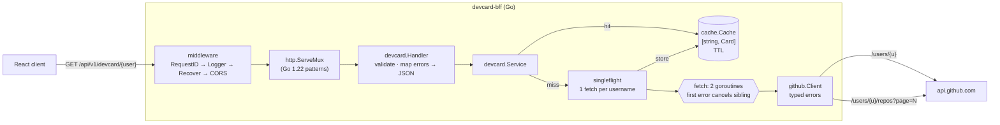

# devcard-bff

A **Backend-for-Frontend** in Go that gives a React client one endpoint for
everything a "developer card" needs. Behind it, the service calls the GitHub
REST API several times, aggregates the results, caches them, and returns them
in the shape the UI renders.

```
GET /api/v1/devcard/{username}
```

## What a BFF is and why you'd use one

A BFF is a thin server owned by the frontend team, with one per client (web,
mobile...). It sits between that client and the general-purpose APIs behind
it. Without one, the React app would have to:

- make **4+ requests** (profile plus paginated repos) and stitch them together in the browser
- download **~100 KB of JSON** for each user to show about 1 KB of it
- either ship a GitHub token to the browser (which leaks it) or live with the **60 requests/hour** unauthenticated limit
- handle GitHub's quirks itself, such as a 403 that sometimes means "rate limited"

The BFF turns all of that into one request with a response shaped for the
UI. It keeps the token on the server, adds a shared cache, and gives the
client a stable error contract. Because the frontend team owns it, the UI
and its API can change together without asking a platform team for changes.

## Architecture



```
cmd/server/          main: config, wiring, graceful shutdown
internal/config      env vars → Config (pure, testable)
internal/github      upstream client: HTTP → typed Go errors
internal/devcard     aggregation (pure), service (cache + singleflight), handler
internal/cache       generic TTL cache
internal/middleware  request ID, access log, recovery, CORS
internal/health      /healthz, /readyz
internal/httpx       shared JSON / error-envelope writers
```

## API

### `GET /api/v1/devcard/{username}`

```bash
curl -s localhost:8080/api/v1/devcard/octocat | jq
```

Response (shortened, with illustrative numbers):

```json
{
  "profile": {
    "login": "octocat",
    "name": "The Octocat",
    "avatarUrl": "https://avatars.githubusercontent.com/u/583231?v=4",
    "bio": "",
    "url": "https://github.com/octocat",
    "followers": 25109
  },
  "topRepos": [
    { "name": "Spoon-Knife", "stars": 14192, "language": "HTML", "url": "https://github.com/octocat/Spoon-Knife" },
    { "name": "Hello-World", "stars": 3996, "language": "", "url": "https://github.com/octocat/Hello-World" }
  ],
  "languages": [
    { "name": "HTML", "percent": 33.3 },
    { "name": "CSS", "percent": 16.7 }
  ],
  "totalStars": 21500
}
```

- `topRepos` lists up to 6 repos, most stars first, with ties sorted by name.
- `languages` is each primary language's share of the user's repos (in percent, one decimal place). Repos with no language are left out.
- `totalStars` adds up the stars on the user's own repos.
- Forks are left out of all three, because their stars belong to the upstream project.
- An empty list comes back as `[]`, never `null`.

### Errors

Every error uses the same envelope, so the client can branch on `code`:

```json
{ "error": { "code": "user_not_found", "message": "GitHub user not found" } }
```

| Situation                          | Status | `code`             | Notes                       |
| ---------------------------------- | ------ | ------------------ | --------------------------- |
| Username fails GitHub's rules      | 400    | `invalid_username` | rejected before any upstream call |
| User doesn't exist                 | 404    | `user_not_found`   |                             |
| GitHub rate limit (403 or 429)     | 503    | `rate_limited`     | `Retry-After: <seconds>`    |
| GitHub took longer than `UPSTREAM_TIMEOUT` | 504 | `upstream_timeout` |                         |
| Any other GitHub failure           | 502    | `upstream_error`   |                             |
| Panic in a handler                 | 500    | `internal_error`   | stack trace is logged, never returned |

```bash
curl -i localhost:8080/api/v1/devcard/this-user-does-not-exist-zz9
curl -i localhost:8080/api/v1/devcard/-bad-name-
```

### Probes

```bash
curl localhost:8080/healthz   # {"status":"ok"}    liveness: the process is serving
curl localhost:8080/readyz    # {"status":"ready"} readiness: 503 once shutdown begins
```

### CORS preflight

```bash
curl -i -X OPTIONS localhost:8080/api/v1/devcard/octocat \
  -H 'Origin: http://localhost:5173' -H 'Access-Control-Request-Method: GET'
```

Every response carries an `X-Request-ID` header. If the client sends one, the
service reuses it (so you can trace a request across systems). It also shows
up in each log line for that request.

## Design decisions

**Caching the aggregated card instead of raw GitHub responses.** The cache
stores the finished `Card`, keyed by the lowercased login (GitHub logins
ignore case). A cache hit costs one map lookup under a read lock and needs no
re-aggregation. Errors are never cached, so a temporary GitHub failure clears
up on the next request. The cache has a size limit (10k entries) and a
janitor goroutine that sweeps out expired entries, so its memory use stays
bounded. It also sends `Cache-Control: public, max-age=60` so the browser can
skip repeat requests too. The trade-off: the cache lives inside one process.
Running several replicas means several caches. If that ever matters, Redis
can sit behind the same interface.

**singleflight to prevent cache stampedes.** Suppose a popular profile's
cache entry expires and 50 requests arrive at once. Without coordination,
that's 50 × 2+ GitHub calls, and it eats the rate limit in seconds.
`singleflight.Group` makes sure only one fetch per username runs at a time.
Every other request waits for that fetch and shares its result. Two details
are worth knowing:

- The shared fetch uses `context.WithoutCancel(ctx)` plus its own timeout.
  Without that, if the *first* caller closed their browser tab, the fetch
  would be cancelled for everyone else waiting on it.
- It uses `DoChan` instead of `Do`, so each waiting caller can still give up
  when *its own* context ends.

**Concurrent fan-out with first-error cancellation.** The profile and the
repos are fetched in two goroutines that share a cancellable context. The
first error is recorded with `sync.Once` and cancels the other request. This
is the `errgroup.WithContext` pattern written out by hand, because only
`singleflight` is allowed from `x/sync`. Each goroutine also recovers from
panics: `recover` only works on the goroutine that panicked, and a panic
inside singleflight would otherwise crash the process.

**Error mapping in one place.** `internal/github` turns HTTP responses into
Go errors (`ErrNotFound`, `*RateLimitError`, `*StatusError`). Callers use
`errors.Is` / `errors.As`, so the checks keep working however many times an
error is wrapped with `%w`. Only `devcard.Handler.writeError` turns those
errors into HTTP responses. A rate limit becomes **503, not 403**, because
the frontend can't do anything to fix it; `Retry-After` tells it when to try
again. GitHub's 403 is ambiguous, so the client only treats it as a rate
limit when `X-RateLimit-Remaining: 0` or `Retry-After` is present.

**Language breakdown by repo count, not bytes.** The repos listing only
includes each repo's *primary* language. Byte-accurate numbers would need one
`/languages` call per repo, which would cost a lot of rate limit for a
cosmetic gain. Percentages are rounded to one decimal place, so they may add
up to 99.9 or 100.1.

**Timeouts at every layer.** The `http.Server` has read, header, write and
idle timeouts. Each upstream fetch has a context deadline (`UPSTREAM_TIMEOUT`).
The GitHub `http.Client` has no timeout of its own on purpose: the context
is the only thing that controls cancellation.

**Graceful shutdown.** On SIGINT or SIGTERM, `/readyz` starts returning 503
so the load balancer stops sending traffic. `http.Server.Shutdown` then waits
up to `SHUTDOWN_TIMEOUT` for in-flight requests to finish.

**Dependencies.** The service uses only the standard library plus
`golang.org/x/sync`, which is pinned to v0.11.0 because newer versions
require Go 1.23 or later. CI tests against both Go 1.22 and the latest
stable release.

## Running

Requires Go 1.22 or later.

```bash
make run                                   # :8080, unauthenticated (60 req/h)
GITHUB_TOKEN=ghp_xxx make run              # 5,000 req/h
make test                                  # all tests, -race
make cover                                 # coverage report → coverage.html
make lint                                  # golangci-lint v2
make docker && docker run --rm -p 8080:8080 -e GITHUB_TOKEN devcard-bff:dev
```

### Configuration

| Variable           | Default                  | Meaning |
| ------------------ | ------------------------ | ------- |
| `PORT`             | `8080`                   | listen port |
| `GITHUB_TOKEN`     | (unset)                  | optional; raises the GitHub limit from 60 to 5,000 requests/hour. A fine-grained token with no extra permissions is enough |
| `CACHE_TTL`        | `5m`                     | how long a card stays cached (Go duration) |
| `ALLOWED_ORIGIN`   | `http://localhost:5173`  | CORS origin(s), comma-separated, or `*` |
| `UPSTREAM_TIMEOUT` | `5s`                     | deadline for one card's GitHub calls |
| `SHUTDOWN_TIMEOUT` | `15s`                    | grace period for in-flight requests |
| `LOG_LEVEL`        | `info`                   | `debug`, `info`, `warn` or `error` |
| `GITHUB_API_URL`   | `https://api.github.com` | e.g. GitHub Enterprise |

If any variable is invalid, the service refuses to start and lists every
problem at once.

### Calling it from React

```ts
type DevCard = {
  profile: { login: string; name: string; avatarUrl: string; bio: string; url: string; followers: number };
  topRepos: { name: string; stars: number; language: string; url: string }[];
  languages: { name: string; percent: number }[];
  totalStars: number;
};

const res = await fetch(`${API}/api/v1/devcard/${encodeURIComponent(user)}`);
if (!res.ok) {
  const { error } = await res.json(); // error.code: "user_not_found" | "rate_limited" | ...
  throw Object.assign(new Error(error.message), { code: error.code, retryAfter: res.headers.get("Retry-After") });
}
const card: DevCard = await res.json();
```

## Testing

The tests never touch the real network. The GitHub API is replaced with
`httptest.Server` fakes.

- **Aggregation:** table-driven tests for top repos (ordering, ties, truncation), language percentages (rounding, empty input) and total stars, plus a check that forks are left out.
- **Handler, through a fake GitHub:** success, 404, 403 and 429 rate limits (checks `Retry-After`), upstream timeout (504), other upstream errors (502), invalid usernames, a cache hit (asserts GitHub was called once, with mixed-case usernames), errors not being cached, and **singleflight** (20 concurrent requests with caching disabled lead to one upstream call).
- **Service:** the first error wins and cancels the sibling request, a caller cancelling doesn't abort the shared fetch, and a panic in a fetch goroutine becomes a 502.
- **Cache:** the exact expiry boundary using an injected clock (no sleeps), TTL reset, eviction, the janitor, and a concurrent-access check under `-race`.
- **Middleware:** request ID handling, JSON access-log fields, panic recovery (including `http.ErrAbortHandler`), and the CORS allow and deny matrix.

Coverage on `internal/` is about 98%. CI fails if it drops below 80%.
